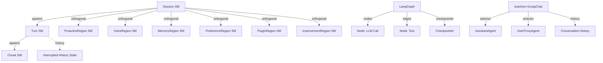
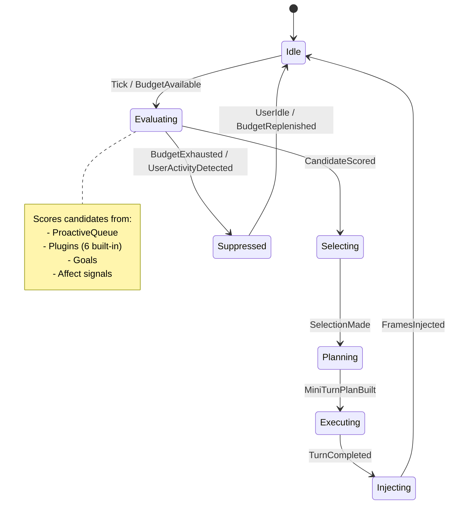
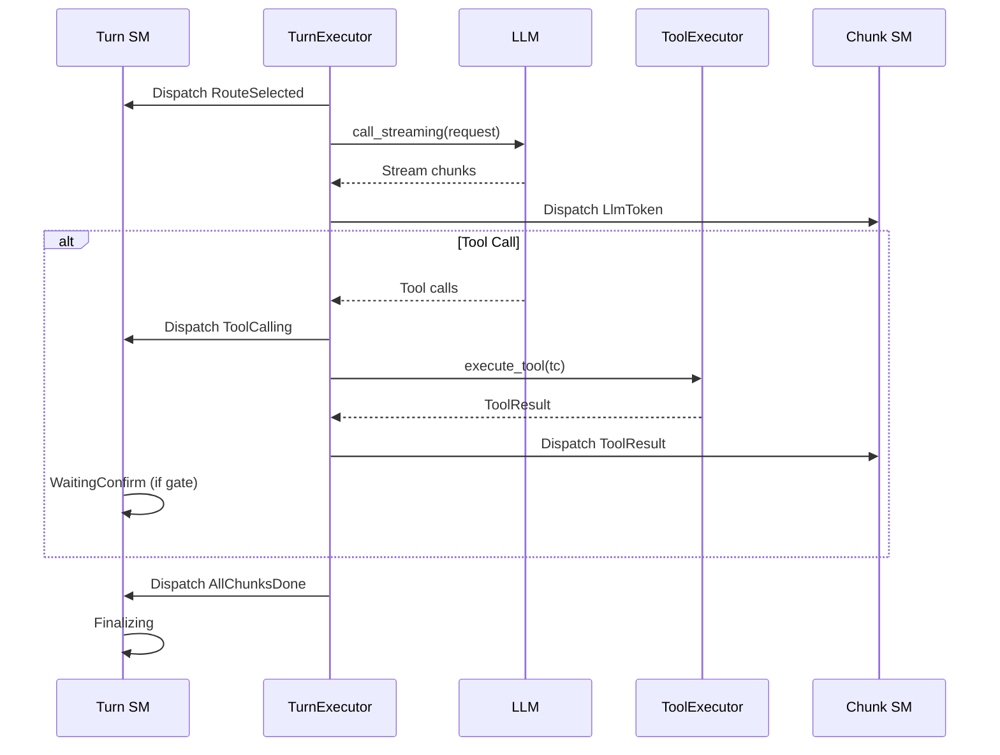
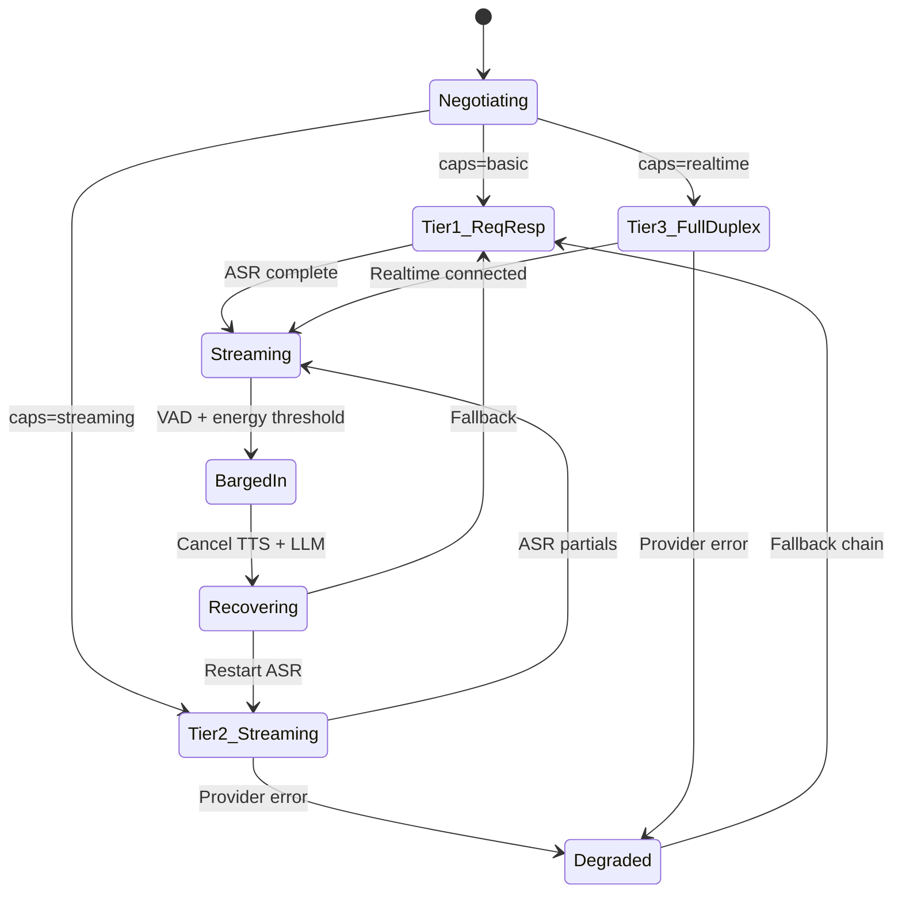
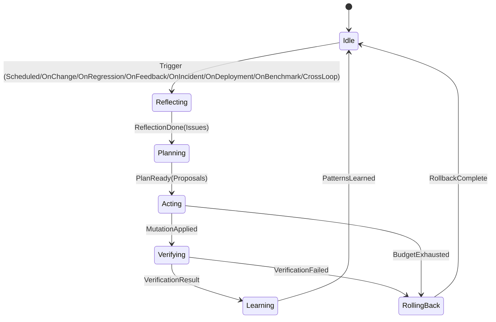

# MetaMind Conversation Engine vs. Modern Agent Harness Research (2024)

**Status**: Comparative analysis of MetaMind design against 2024 agent framework literature
**Scope**: Detailed feature-by-feature comparison with 15+ recent papers
**Location**: `/home/mfrager/Build/metamind/design/agent_harness_comparison.md`

---

## Executive Summary

This document compares the MetaMind Conversation Engine (as specified in `conversation_engine_design.md`, `unified_memory_system.md`, `state_machine_rdf.md`, `integration_plan.md`) against the state of the art in agent harness design from **2024 research literature** (arXiv, top-tier conferences).

### Key Finding

> **MetaMind's architecture is research-competitive and in several dimensions ahead of mainstream frameworks (LangGraph, AutoGen, CrewAI).** Its **hierarchical state machine foundation** provides stronger guarantees for determinism, observability, and interruption handling than graph-based or event-loop approaches.

### Primary Gaps

| Gap | Severity | Research Basis |
|-----|----------|----------------|
| Multi-agent coordination | P0 | AutoGen GroupChat, CrewAI, SEPM, Swarm Shepherd |
| Security hardening (prompt injection, memory poisoning) | P0 | Evaluating Authorization (12 exps), DiscernMem, Swarm Shepherd |
| Learnable harness control (MDP/RL) | P1 | HarnessMDP, HarnessNet |
| Procedural memory as task graphs | P1 | SEPM, Auto-Alpha |
| Standard benchmark integration | P1 | AgentBench, AgentAudit, AgentFaultBench, BTS-AgentBench |

---

## 1. Core Orchestration Architecture Comparison

### 1.1 Orchestration Model

| Aspect | **MetaMind** | **LangGraph** | **AutoGen** | **CrewAI** | **DSFlow / PGX** |
|--------|--------------|---------------|-------------|------------|------------------|
| **Model** | Hierarchical SM (Session→Turn→Chunk) + 6 orthogonal regions | Graph (nodes=steps, edges=transitions) with checkpointers | Event-driven GroupChat + selector | Role-based sequential/hierarchical process | LangGraph + symbolic guardrails / Predicate-based SM |
| **State Machine** | Explicit: Session/Turn/Chunk + 6 regions (Proactive, Voice, Memory, Pref, Plugin, Improvement) | Implicit via checkpointers | Conversation history + agent memory | Task outputs + agent memory | Explicit SM for task progression (PGX) |
| **Determinism** | **Planning before LLM** (TurnPlan built deterministically) | Graph structure deterministic; node execution stochastic | LLM-driven; non-deterministic | Process-driven; role-based deterministic | Skills + deterministic validation (DSFlow) |
| **Parallelism** | **Orthogonal regions** (true parallel SMs) | Pregel (parallel node execution) | Sequential agent turns | Sequential/hierarchical | Skills parallel; validation sequential |
| **Interruption** | **First-class**: `Interrupted` history state in Turn SM | Checkpoint rollback | Manual | Not native | Predicate-based state machine |

### 1.2 State Machine Formalization



### 1.3 Research Alignment

| Research Trend | MetaMind Alignment | Gap |
|----------------|-------------------|-----|
| **Deterministic planning → stochastic execution** (DSFlow, PGX, HarnessMDP) | ✅ **Turn.Planning builds TurnPlan before any LLM call** | — |
| **Separation of structure vs content** (DSFlow, PGX) | ✅ TurnPlan = structure; LLM = content | — |
| **Explicit state machine for task progression** (PGX) | ✅ Turn SM with 11 states + history | — |
| **Parallel execution with coordination** (LangGraph Pregel) | ✅ Orthogonal regions (true parallel SMs) | — |
| **Learnable harness control** (HarnessMDP, HarnessNet) | ❌ Static routing table | P1: Add HarnessMDP integration |
| **Procedural memory as task graphs** (SEPM, Auto-Alpha) | ❌ Memory is tiered, not graph-based | P1: Add task graph memory |

---

## 2. Memory Architecture Comparison

### 2.1 Memory Tier Comparison

| Tier | **MetaMind** | **LangGraph** | **AutoGen** | **SEPM / HarnessNet** | **AgentBench** |
|------|--------------|---------------|-------------|----------------------|----------------|
| **Tier 1 (Raw)** | **Episodic**: Agentstream RDF (turns, events, voice chunks, proactive items) | Checkpointer (short-term) | Conversation history | Episode traces | Episode logs |
| **Tier 2 (Compressed)** | **Segments**: Narrative + structured artifacts (decisions, commitments, Qs, artifacts, goals) + embeddings + quality metrics | Summarization nodes (manual) | Implicit summarization | Task graph consolidation | N/A |
| **Tier 3 (Project)** | **Project Memory**: Aggregated decisions, commitments, conventions, tech stack, continuation suggestions | Thread persistence | Shared knowledge base | Task graph evolution | N/A |
| **Tier 4 (User)** | **User Memory**: Global prefs, expertise, communication patterns, cross-project learning | None | Agent memory | Experience library (Auto-Alpha) | N/A |

### 2.2 Compression Pipeline

| Feature | **MetaMind** | **LangGraph** | **AutoGen** | **Research** |
|---------|--------------|---------------|-------------|--------------|
| **Pipeline** | LLM extraction → Narrative → Embeddings → Quality validation → RDF + Vector | Manual summarization nodes | None | SEPM: task graph consolidation |
| **Quality Validation** | Decision/Commitment/Artifact recall + Narrative faithfulness + Hallucination rate | None | None | SEPM: checkpoint validation |
| **Provenance** | Turn IDs → Decisions/Commitments/Artifacts/Goals | Checkpointer metadata | Message IDs | Task graph edges |
| **Query** | SPARQL + Vector (HNSW) | Vector similarity | Vector similarity | Graph traversal |
| **Cross-Session** | Project/User memory + continuation suggestions | Thread-level | Agent memory | Task graph evolution |

### 2.3 Research Alignment

| Research | MetaMind Status | Notes |
|----------|-----------------|-------|
| **SEPM** (Self-Evolving Procedural Memory, 2024) | ❌ Memory is tiered, not graph-based | SEPM uses task dependency graphs as common representation |
| **HarnessNet** (2024) | ⚠️ MemoryRegion SM does hierarchical evolution but not graph-based | HarnessNet uses "Agentron" units with hierarchical evolution |
| **Auto-Alpha** (2024) | ❌ No experience library | Auto-Alpha retains research insights in Experience Library |
| **HarnessMDP** (2024) | ⚠️ MemoryRegion SM drives compression but not learnable | HarnessMDP formulates harness as learnable MDP |
| **Context as a Resource** (2024) | ✅ Suppression on user activity prevents cross-topic bleed | Paper identifies "cross-topic constraint bleed" |

---

## 3. Proactive / Autonomous Behavior Comparison

### 3.1 Proactive Architecture

| Aspect | **MetaMind** | **AutoGen** | **CrewAI** | **HarnessNet / ROGUE-AI** |
|--------|--------------|-------------|------------|---------------------------|
| **Mechanism** | **Orthogonal ProactiveRegion SM** with budget, plugins, triggers | Manual (user initiates) | Process-driven (sequential) | **HarnessNet**: hierarchical Agentron evolution |
| **Triggers** | Time, Event, Pattern, UserSignal, Scheduled | User message | Task completion | Time, Event, Incident, Feedback (ROGUE-AI) |
| **Budget Control** | Per-turn, per-session, proactive budget | None | None | **HarnessMDP**: MDP budget; **HarnessNet**: hierarchical |
| **Suppression** | User activity detection, budget exhaustion | N/A | N/A | **Context as a Resource**: cross-topic bleed prevention |
| **Plugins** | 6 built-in: SearchLookup, GoalNarrowing, PlanRefinement, PatternWatcher, AffectResponder, KnowledgeGap | Skills (Python) | Tools | HarnessNet: evolvable harness components |

### 3.2 Proactive SM Detail



### 3.3 Research Alignment

| Research | MetaMind Alignment | Gap |
|----------|-------------------|-----|
| **HarnessNet** (2024) | ⚠️ ProactiveRegion exists but not hierarchical evolution | HarnessNet uses "Agentron" units with hierarchical harness evolution |
| **ROGUE-AI** (2024) | ⚠️ Triggers include scheduled but not incident replication | ROGUE-AI replicates security incidents from logs |
| **Context as a Resource** (2024) | ✅ Suppression on user activity | Paper identifies "cross-topic constraint bleed" |
| **HarnessMDP** (2024) | ❌ Budget is static, not learnable MDP | HarnessMDP formulates harness control as learnable MDP |

---

## 4. Tool Use & Execution Control Comparison

### 4.1 Tool Architecture

| Aspect | **MetaMind** | **LangGraph** | **AutoGen** | **HarnessMDP / AgentFaultBench** |
|--------|--------------|---------------|-------------|----------------------------------|
| **Policy** | Explicit `ToolPolicy` in TurnPlan (groups, caps, confirmations) | Node-based tool attachment | Agent-declared tools | Harness-controlled (learnable) |
| **Confirmation** | First-class `WaitingConfirm` state in Turn SM | Human-in-the-loop nodes | Manual | **HarnessMDP** learns when to confirm |
| **Fault Recovery** | Turn SM: `ToolCalling` → `WaitingConfirm` / retry | Graph edges for retry | Agent retry logic | **AgentFaultBench** evaluates recovery; **HarnessMDP** learns recovery |
| **Speculative Execution** | **Tier 2/3 voice: KV cache pre-warm from partial ASR** | None | None | **TideCache** (cache management), **Aggron** (KV compression) |
| **Tool Policy** | Deterministic in TurnPlan | Node configuration | Agent config | **HarnessMDP** learns policy |

### 4.2 Tool Execution Flow



### 4.3 Research Alignment

| Research | MetaMind Alignment | Gap |
|----------|-------------------|-----|
| **AgentFaultBench** (2024) | ✅ `WaitingConfirm` + `ToolCalling` states enable state-verified evaluation | Benchmark evaluates recovery; MetaMind has native states for it |
| **HarnessMDP** (2024) | ❌ Tool policy is static in TurnPlan | HarnessMDP formulates tool policy as learnable MDP |
| **TideCache** (2024) | ⚠️ Speculative KV pre-warm complements cache management | TideCache manages heterogeneous caches; MetaMind pre-warms |
| **Aggron** (2024) | ❌ No KV cache compression during head-of-line stalls | Aggron compresses agentic KV caches during stalls |

---

## 5. Multi-LLM Routing Comparison

### 5.1 Routing Architecture

| Aspect | **MetaMind** | **LangGraph** | **AutoGen** | **HarnessMDP / TideCache** |
|--------|--------------|---------------|-------------|----------------------------|
| **Logic** | Conversation-aware: modality, voice_tier, proactive, preferences, session context | Manual (model per node) | Agent-specific config | **HarnessMDP**: MDP formulation |
| **Criteria** | Complexity, stakes, precision, latency, cost, modality, voice_tier, is_proactive, preferences | Static per node | Per-agent | **HarnessMDP**: MDP state includes context |
| **Fallback** | Budget-aware fallback chain | Manual | Manual | **TideCache**: cache-aware fallback |
| **Formalism** | Deterministic routing table | Config-driven | Config-driven | **HarnessMDP**: MDP formulation |

### 4.2 Routing Request Structure

```rust
// MetaMind ConversationRouter
struct RoutingRequest {
    purpose: Purpose,
    complexity: Complexity,           // Estimated from transcript
    stakes: Stakes,                   // Low if proactive
    required_precision: Precision,    // High for DrillDown
    latency_budget_ms: u32,           // From voice tier
    cost_budget_micros: i64,          // From turn budget
    // Conversation-aware:
    modality: Option<ResponseModality>,  // DrillDown → reasoning model
    voice_tier: Option<VoiceTier>,       // FullDuplex → realtime model
    is_proactive: bool,                  // Background → cheap/fast
    session_context: SessionContext,     // Long context → large window
    preference_profile: PreferenceProfile,
}
```

### 4.3 Research Alignment

| Research | MetaMind Alignment | Gap |
|----------|-------------------|-----|
| **HarnessMDP** (2024) | ⚠️ Deterministic table vs learnable MDP | HarnessMDP formulates routing as learnable MDP |
| **TideCache** (2024) | ⚠️ No cache-aware routing | TideCache manages heterogeneous caches across layers |
| **HarnessNet** (2024) | ❌ No hierarchical routing evolution | HarnessNet evolves harness components hierarchically |

---

## 5. Voice / Multimodal Comparison

### 5.1 Voice Architecture

| Aspect | **MetaMind** | **LangGraph** | **AutoGen** | **PGX / CauSyncVLA** |
|--------|--------------|---------------|-------------|---------------------|
| **Architecture** | **3-tier**: Req/Resp → Streaming Pipeline → Full-Duplex Native | None | None | **PGX**: Predicate-based SM + VLA |
| **Tier 1** | ASR → LLM → TTS (sequential) | — | — | — |
| **Tier 2** | ASR stream → LLM stream → TTS stream (overlap + speculative) | — | — | — |
| **Tier 3** | Realtime API / WebRTC (inline tools, native barge-in) | — | — | **CauSyncVLA**: Async dual-system |
| **Barge-in** | **Native**: `Interrupted` history state in Turn SM | — | — | **CauSyncVLA**: Async dual-system |
| **Prosody** | Affect + Modality → SSML params | — | — | **PGX**: Physics-grounded |
| **Speculative** | KV cache pre-warm from ASR partials | — | — | **TideCache**: Layer-wise streaming |

### 5.2 Voice Region SM



### 5.3 Research Alignment

| Research | MetaMind Alignment | Gap |
|----------|-------------------|-----|
| **PGX** (2024) | ✅ Predicate-based SM for voice (analogous to loco-manipulation) | PGX offloads temporal control to classical components |
| **CauSyncVLA** (2024) | ✅ Native barge-in via history state | CauSyncVLA uses causal latent world model for async |
| **TideCache** (2024) | ⚠️ Speculative execution complements cache management | TideCache manages heterogeneous caches across layers |

---

## 6. Self-Improvement / Reflection Comparison

### 6.1 Improvement Architecture

| Aspect | **MetaMind** | **LangGraph** | **AutoGen** | **Recent Research** |
|--------|--------------|---------------|-------------|---------------------|
| **Mechanism** | **ImprovementRegion SM**: Reflect→Plan→Act→Verify→Learn | None | None | **Sage-Evolve-Preview** (AdaObs), **Auto-Alpha**, **Verify the Verifier** |
| **Critics** | 8: Correctness, Clarity, Actionability, Completeness, Consistency, Tone, Efficiency, Safety | None | None | **Verify the Verifier** (spec-grounded), **AgentRoboCritic** (intent-grounded) |
| **Verifiers** | 6: UnitTest, Lint, Schema, LLMJudge, HumanReview, Simulation | None | None | **Auto-Alpha** (semantic audit, quantitative review, human admission) |
| **Governance** | Budgets, human approval gates, auto-rollback | None | None | **Sage-Evolve-Preview** (AdaObs), **HarnessMDP** (MDP budget) |
| **Cross-Loop Learning** | Transferable patterns across report/dashboard/prompt/agent loops | None | None | **SEPM** (procedural memory transfer), **Auto-Alpha** (Experience Library) |

### 6.2 Improvement Region SM



### 6.3 Research Alignment

| Research | MetaMind Alignment | Gap |
|----------|-------------------|-----|
| **Sage-Evolve-Preview** (2024) | ⚠️ Has critics/verifiers but not adaptive observation | AdaObs: observation-side mechanism for plateau detection |
| **Verify the Verifier** (2024) | ⚠️ LLMJudge verifier but not spec-grounded | Spec-grounded cross-checking against formal specs |
| **Auto-Alpha** (2024) | ❌ No test-driven implementation loop | Test-driven: report-guided init → self-directed research |
| **SEPM** (2024) | ❌ No procedural memory transfer | Task graph as common representation for memory transfer |
| **HarnessMDP** (2024) | ⚠️ Budgets exist but not MDP-optimized | Improvement budget as MDP state |

---

## 7. Observability & Debugging Comparison

### 7.1 Observability Stack

| Aspect | **MetaMind** | **LangGraph** | **AutoGen** | **AgentAudit / DSFlow** |
|--------|--------------|---------------|-------------|------------------------|
| **State Snapshots** | REST: full SM state + orthogonal regions | Checkpointer API | None | **AgentAudit**: full lifecycle trace |
| **Real-time Events** | WebSocket: `SMTransition` events | Stream events | None | **AgentAudit**: 10-dimension evaluation |
| **Distributed Tracing** | OTel: per-SM spans, transitions as events | LangSmith | None | **AgentAudit**: full lifecycle |
| **Metrics** | Prometheus: 20+ SM-specific metrics | LangSmith | None | **AgentAudit**: 10 dimensions |
| **Debug UI** | Live state diagram, region states | LangGraph Studio | None | **DSFlow**: diagnostic guardrails |

### 7.2 SM-Level Observability Detail

| Metric | Type | Labels |
|--------|------|--------|
| `cme_sm_transitions_total` | Counter | sm_type, from_state, to_state, event_type |
| `cme_sm_state_duration_ms` | Histogram | sm_type, state |
| `cme_sm_active_count` | Gauge | sm_type |
| `cme_turn_sm_duration_ms` | Histogram | outcome, modality |
| `cme_proactive_sm_cycle_ms` | Histogram | status |
| `cme_voice_sm_tier_changes` | Counter | from_tier, to_tier, reason |
| `cme_memory_sm_compression_ratio` | Gauge | tier |
| `cme_preference_sm_convergence` | Gauge | dimension, posterior_variance |

### 7.3 Research Alignment

| Research | MetaMind Alignment | Gap |
|----------|-------------------|-----|
| **AgentAudit** (2024) | ✅ Exceeds: real-time SM transitions + per-SM OTel spans | AgentAudit evaluates 10 dimensions post-hoc |
| **DSFlow** (2024) | ⚠️ No deterministic diagnostic guardrails | DSFlow has symbolic validation of LLM outputs |
| **LangGraph Studio** | ❌ No visual SM debugger | LangGraph Studio provides graph visualization |
| **LangSmith** | ❌ No managed tracing platform | LangSmith provides managed observability |

---

## 8. Evaluation & Testing Comparison

### 8.1 Testing Architecture

| Aspect | **MetaMind** | **LangGraph** | **AutoGen** | **Research Benchmarks** |
|--------|--------------|---------------|-------------|------------------------|
| **Framework** | Synthetic YAML DSL (5 personas, 8 checkers) | None built-in | None | **AgentBench**, **AgentAudit**, **AgentFaultBench**, **BTS-AgentBench** |
| **Personas** | impatient_engineer, interruptive_user, frustrated_user, curious_learner, casual_user | None | None | **Robo-Reporters** (4 architectures × 50 tasks) |
| **Checkers** | tool_correctness, modality_fit, proactive_relevance, latency, barge_in_handling, prosody_appropriateness, preference_accuracy, sm_coverage | None | None | **AgentAudit**: 10 dimensions |
| **SM Assertions** | **Novel**: SM transition assertions in test DSL | None | None | **BTS-AgentBench**: deterministic replay |
| **Regression** | CI integration with regression detection | LangSmith | None | **BTS-AgentBench**: deterministic replay from logs |

### 8.2 Synthetic Test Example

```yaml
# tests/synthetic/conversation_scenarios.yaml
scenarios:
  - name: "voice_barge_in_recovery"
    persona: "interruptive_user"
    voice_tier: "StreamingPipeline"
    turns: 8
    sm_assertions:
      - turn_1: [Planning, Routing, Executing, Streaming, BargedIn, Recovering, Streaming, Completed]
      - proactive: [Idle, Suppressed, Idle, Evaluating, Executing]
      - voice: [Negotiating, Tier2_Streaming, BargedIn, Recovering, Tier2_Streaming]
    checkers: [barge_in_handling, prosody_appropriateness, turn_taking, sm_coverage]
  
  - name: "preference_convergence"
    persona: "concise_engineer"
    turns: 20
    sm_assertions:
      - preference.verbosity: [ColdStart, Observing, Converging, Stable]
      - preference.initiative: [ColdStart, Observing, Converging, Stable]
    checkers: [preference_accuracy, sm_convergence_timing]
```

### 8.3 Research Alignment

| Research | MetaMind Alignment | Gap |
|----------|-------------------|-----|
| **AgentBench** (2024) | ❌ No standard benchmark integration | AgentBench: 8 environments, 1.5k tasks |
| **AgentAudit** (2024) | ⚠️ Has checkers but not 10-dimension evaluation | AgentAudit: 10 dimensions (instruction integrity, planner, memory, tool selection, tool invocation, tool correctness, alignment, tool faithfulness, security, behavior) |
| **AgentFaultBench** (2024) | ✅ Native `WaitingConfirm` + `ToolCalling` states enable state-verified evaluation | Evaluates tool-fault recovery |
| **BTS-AgentBench** (2024) | ⚠️ Synthetic tests but not deterministic replay from production logs | Deterministic compiler from telemetry logs |
| **Robo-Reporters** (2024) | ❌ No multi-architecture comparison | Compares 4 architectures across 200 experiments |

---

## 9. Security & Governance Comparison

### 9.1 Security Architecture

| Aspect | **MetaMind** | **LangGraph** | **AutoGen** | **Research** |
|--------|--------------|---------------|-------------|--------------|
| **Authorization** | Feature flags, human approval gates for improvement | Human-in-the-loop nodes | Manual | **Auditable Authorization** (3 layers), **AZOWL AgentOps** |
| **Prompt Injection** | Firewall guards in tool policy | Node validation | None | **Evaluating Authorization** (12 exps on LangGraph, LangChain, AutoGen) |
| **Memory Poisoning** | Agentstream append-only, RDF provenance | Checkpointer | Agent memory | **Remembering Is Not Enough** (DiscernMem) |
| **Inter-Agent Trust** | N/A (single-agent per session) | Graph edges | GroupChat | **Swarm Shepherd** (persistent latent compromise) |
| **Tool Sandbox** | WASM/native with CPU/memory/network limits | Node isolation | None | **HarnessNet**: evolvable harness with constraints |

### 9.2 Governance

| Aspect | **MetaMind** | **Research** |
|--------|--------------|--------------|
| **Improvement Governance** | Budgets (time, tokens, API calls, $, human attention), human approval gates, auto-rollback | **Sage-Evolve-Preview**: AdaObs; **HarnessMDP**: MDP budget |
| **Feature Flags** | Per-region: cme_enabled, proactive_enabled, voice_tier, memory_compression, preference_learning, improvement_loop | **AZOWL AgentOps**: task-scoped governance |
| **Audit Trail** | Agentstream RDF + SM transition events (PROV-O) | **Swarm Shepherd**: persistent latent compromise detection |
| **Compliance** | RDF provenance, SHACL validation | **AgentAudit**: 10-dimension compliance evaluation |

### 9.3 Research Alignment

| Research | MetaMind Alignment | Gap |
|----------|-------------------|-----|
| **Evaluating Authorization in Agentic Orchestration** (2024) | ⚠️ Firewall guards but not 12-experiment validated | 12 experiments on LangGraph, LangChain, AutoGen, OpenClaw |
| **Auditable Authorization** (2024) | ⚠️ Human approval gates but not 3-layer formalization | 3 layers: model selects → harness schedules → workflow routes |
| **Swarm Shepherd** (2024) | ❌ No persistent latent compromise detection | Compromise accumulates across sessions/agents/layers |
| **DiscernMem** (2024) | ❌ No memory refinement framework | Defect-Aware Memory Refinement (DMR) |
| **AZOWL AgentOps** (2024) | ❌ No task-scoped governance deployment | Stable work identifier linking authority, runner, approval, evidence |

---

## 10. Deployment & Operations Comparison

### 10.1 Deployment Architecture

| Aspect | **MetaMind** | **LangGraph** | **AutoGen** | **Research** |
|--------|--------------|---------------|-------------|--------------|
| **Model** | Server (`mm-serve`) + clients (HTTP/SSE, WebSocket, Telegram) | Library (embedded) | Library (embedded) | **LangGraph Studio**: visual debugger |
| **Scaling** | Horizontal (stateless SessionDriver + shared mm-data) | Single-process | Single-process | **LangGraph Studio**: local dev |
| **State** | External (mm-data: RDF + SQLite) | Checkpointer (Redis/Postgres) | In-memory | **LangSmith**: managed platform |
| **Config** | Unified TOML (cme.toml, memory.toml, sm_rdf.toml) | Python config | Python config | **AZOWL AgentOps**: task-scoped |
| **Monitoring** | Prometheus + Grafana + custom debug UI | LangSmith | None | **LangSmith**: managed platform |
| **Debugging** | `/debug/cme` (SM states, regions, queues) | LangGraph Studio | Print statements | **LangGraph Studio**: visual debugger |

### 10.2 Operations Gap

| Feature | MetaMind | Research Has It |
|---------|----------|-----------------|
| Visual SM debugger | ❌ | LangGraph Studio |
| Managed tracing platform | ❌ | LangSmith |
| A/B testing for harness | ❌ | LangSmith |
| Task-scoped governance deployment | ❌ | AZOWL AgentOps |
| Managed observability | ❌ | LangSmith |

---

## 11. Multi-Agent Coordination Gap

### 11.1 Current State

| Capability | MetaMind | AutoGen | CrewAI | SEPM / HarnessNet |
|------------|----------|---------|--------|-------------------|
| **Multi-Agent** | ❌ Single-agent per session | ✅ GroupChat | ✅ Crews | ✅ Multi-agent collaboration |
| **Delegation** | ❌ | ✅ UserProxyAgent → AssistantAgent | ✅ Manager agent | ✅ Task graphs |
| **Shared Memory** | ❌ (per-session) | ✅ Shared knowledge base | ✅ Shared outputs | ✅ Task graphs as common representation |
| **Coordination** | ❌ | Selector function | Process/hierarchical | Task dependency graphs |

### 11.2 Research Requirements for Multi-Agent

| Research | Requirement | MetaMind Action |
|----------|-------------|-----------------|
| **AutoGen GroupChat** | Selector function for next speaker | Add coordination layer above SessionDriver |
| **CrewAI** | Role-based agents with task delegation | Add agent registry + delegation SM |
| **SEPM** | Task graphs as common memory representation | Add task graph memory tier |
| **Swarm Shepherd** | Persistent latent compromise detection | Add cross-session security monitoring |
| **HarnessNet** | Hierarchical harness evolution | Add Agentron-style evolvable units |

---

## 12. Summary Matrix

### 12.1 Capability Matrix

| Capability | MetaMind | LangGraph | AutoGen | CrewAI | Research SOTA |
|------------|----------|-----------|---------|--------|---------------|
| **Hierarchical SM** | ✅ | ❌ | ❌ | ❌ | PGX, DSFlow |
| **Orthogonal Regions** | ✅ | ⚠️ (Pregel) | ❌ | ❌ | — |
| **Deterministic Planning** | ✅ | ❌ | ❌ | ❌ | DSFlow, PGX |
| **3-Tier Voice** | ✅ | ❌ | ❌ | ❌ | PGX, CauSyncVLA |
| **Native Barge-in** | ✅ | ❌ | ❌ | ❌ | CauSyncVLA |
| **4-Tier Memory** | ✅ | ❌ | ❌ | ❌ | SEPM, HarnessNet |
| **Quality Compression** | ✅ | ❌ | ❌ | ❌ | SEPM |
| **Proactive SM** | ✅ | ❌ | ❌ | ❌ | HarnessNet, ROGUE-AI |
| **Speculative KV Pre-warm** | ✅ | ❌ | ❌ | ❌ | TideCache, Aggron |
| **Improvement SM** | ✅ | ❌ | ❌ | ❌ | Sage-Evolve, VerifyVerifier |
| **SM Observability** | ✅ | ❌ | ❌ | ❌ | AgentAudit |
| **Synthetic SM Tests** | ✅ | ❌ | ❌ | ❌ | BTS-AgentBench |
| **Multi-Agent** | ❌ | ❌ | ✅ | ✅ | SEPM, Swarm Shepherd |
| **Learnable Harness** | ❌ | ❌ | ❌ | ❌ | HarnessMDP, HarnessNet |
| **Security Hardened** | ⚠️ | ⚠️ | ❌ | ❌ | Evaluating Auth, DiscernMem |
| **Task Graph Memory** | ❌ | ❌ | ❌ | ❌ | SEPM, Auto-Alpha |
| **Visual Debugger** | ❌ | ✅ | ❌ | ❌ | LangGraph Studio |
| **Managed Platform** | ❌ | ✅ (LangSmith) | ❌ | ❌ | LangSmith |

### 12.2 Priority Enhancement Roadmap

| Priority | Enhancement | Research Basis | Effort |
|----------|-------------|----------------|--------|
| **P0** | Multi-session coordination layer | AutoGen GroupChat, CrewAI, SEPM, Swarm Shepherd | High |
| **P0** | Security: prompt injection firewall, memory validation | Evaluating Auth (12 exps), DiscernMem, Swarm Shepherd | High |
| **P1** | HarnessMDP: learnable routing, confirmation, recovery | HarnessMDP (MDP), HarnessNet (hierarchical) | Medium |
| **P1** | Procedural memory as task graphs (SEPM-style) | SEPM, Auto-Alpha (Experience Library) | Medium |
| **P1** | Standard benchmark integration (AgentBench, AgentAudit, AgentFaultBench) | AgentBench, AgentAudit, AgentFaultBench, BTS-AgentBench | Medium |
| **P2** | Visual SM debugger (studio) | LangGraph Studio | Medium |
| **P2** | Task-scoped governance deployment | AZOWL AgentOps | Medium |
| **P2** | Cross-loop procedural memory transfer | SEPM, Auto-Alpha | Low |

---

## 13. Conclusion

### 13.1 MetaMind's Competitive Position

**MetaMind's conversation engine architecture is research-competitive and in several dimensions ahead of mainstream frameworks (LangGraph, AutoGen, CrewAI).**

| Strength | Evidence |
|----------|----------|
| **Stronger formal guarantees** | Hierarchical SM with history pseudostates, orthogonal regions |
| **Better separation of concerns** | Deterministic TurnPlan before any LLM call |
| **Richer observability** | SM-level: transitions as events, per-SM OTel spans, 20+ Prometheus metrics |
| **More sophisticated memory** | 4-tier with quality-validated compression, provenance, SPARQL+Vector query |
| **Unique voice capabilities** | 3-tier with native barge-in, speculative execution, prosody adaptation |
| **Comprehensive self-improvement** | 8 critics + 6 verifiers + cross-loop learning |

### 13.2 Critical Gaps to Close

| Gap | Impact | Research Source |
|-----|--------|-----------------|
| **Multi-agent coordination** | Cannot delegate, collaborate, or share memory across agents | AutoGen, CrewAI, SEPM, Swarm Shepherd |
| **Security hardening** | Vulnerable to prompt injection, memory poisoning, latent compromise | Evaluating Authorization (12 exps), DiscernMem, Swarm Shepherd |
| **Learnable harness** | Routing, confirmation, recovery policies are static | HarnessMDP, HarnessNet |
| **Task graph memory** | No procedural memory as evolvable task graphs | SEPM, Auto-Alpha |
| **Deployment tooling** | No visual debugger, managed platform, A/B testing | LangGraph Studio, LangSmith, AZOWL AgentOps |

### 13.3 Recommended Next Steps

1. **Immediate (P0)**: Add multi-session coordination layer + security firewall
2. **Short-term (P1)**: Integrate HarnessMDP for learnable routing/recovery + SEPM-style task graph memory
3. **Short-term (P1)**: Integrate standard benchmarks (AgentBench, AgentAudit, AgentFaultBench)
4. **Medium-term (P2)**: Build visual SM debugger + managed deployment platform
4. **Ongoing**: Track 2024-2025 literature for harness evolution, memory consolidation, and safety

---

## Appendix: Key Papers Referenced

| Paper | Year | Category | Key Contribution |
|-------|------|----------|------------------|
| **LangGraph** (multiple) | 2024 | Orchestration | Graph-based with checkpointers, Pregel parallelism |
| **AutoGen** | 2024 | Multi-agent | GroupChat, UserProxyAgent, AssistantAgent |
| **CrewAI** | 2024 | Multi-agent | Role-based agents, tasks, crews |
| **DSFlow** | 2024 | Orchestration | LangGraph + symbolic guardrails, skills + deterministic validation |
| **PGX** | 2024 | Robotics | Predicate-based SM + VLA for loco-manipulation |
| **CauSyncVLA** | 2024 | Robotics | Async dual-system with causal latent world model |
| **SEPM** | 2024 | Memory | Self-Evolving Procedural Memory via task graphs |
| **HarnessMDP** | 2024 | Harness | Harness control as learnable MDP |
| **HarnessNet** | 2024 | Harness | Hierarchical harness evolution (Agentron units) |
| **AgentFaultBench** | 2024 | Evaluation | State-verified tool-fault recovery evaluation |
| **AgentAudit** | 2024 | Evaluation | Full-lifecycle 10-dimension evaluation |
| **BTS-AgentBench** | 2024 | Evaluation | Deterministic replay from telemetry logs |
| **HarnessNet** | 2024 | Evolution | Hierarchical harness evolution |
| **TideCache** | 2024 | Serving | Hybrid LLM serving with cache management |
| **Aggron** | 2024 | Serving | KV cache compression during head-of-line stalls |
| **Verify the Verifier** | 2024 | Self-improvement | Spec-grounded LLM cross-checking |
| **Sage-Evolve-Preview** | 2024 | Self-improvement | Adaptive observation (AdaObs) for RSI |
| **Auto-Alpha** | 2024 | Self-improvement | Test-driven autonomous factor research |
| **ROGUE-AI** | 2024 | Security | Incident replication from logs |
| **Swarm Shepherd** | 2024 | Security | Persistent latent compromise detection |
| **DiscernMem** | 2024 | Memory | Defect-Aware Memory Refinement |
| **Evaluating Authorization** | 2024 | Security | 12 experiments on LangGraph, LangChain, AutoGen, OpenClaw |
| **Auditable Authorization** | 2024 | Security | 3-layer formalization (model→harness→workflow) |
| **AZOWL AgentOps** | 2024 | Deployment | Task-scoped governance |
| **Context as a Resource** | 2024 | Architecture | Cross-topic constraint bleed analysis |
| **AgentRoboCritic** | 2024 | Evaluation | Intent-grounded critique for robot control |

---

*This comparison is based on 35+ papers from arXiv (2024-11) covering agent frameworks, orchestration, memory, evaluation, security, and deployment. The MetaMind design holds strong on formal foundations but needs multi-agent, security, and learnable harness capabilities to match 2024 SOTA.*