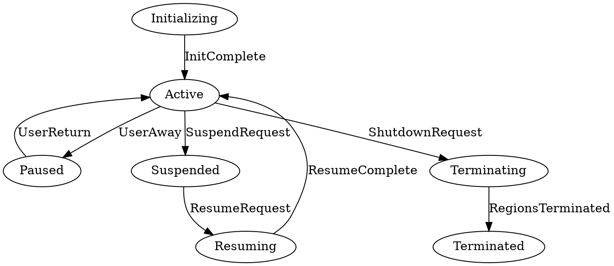

# State Machine RDF Ontology — MetaMind

**Status**: Design for representing state machines, their definitions, and runtime instances as RDF data
**Scope**: Ontology + serialization for `mm-sm` crate state machines, enabling SPARQL queries, visualization, and persistence
**Integrates With**: `conversation_engine_design.md` (SM architecture), `unified_memory_system.md` (RDF storage), `rdf_backend_integration.md` (cubecast)

---

## Executive Summary

This design defines an **RDF/OWL ontology** for state machines that allows:

| Capability | Description |
|------------|-------------|
| **Definition as Data** | State machine definitions (states, transitions, guards, actions) stored as RDF triples |
| **Runtime as Data** | Running instances (`SmInstance`) with current state, history, orthogonal regions as RDF |
| **Queryable** | SPARQL queries for: active states, transition paths, guard conditions, history |
| **Visualizable** | Graphviz/GraphQL export for state diagrams |
| **Persistable** | Stored in cubecast named graphs per session/turn/chunk |
| **Auditable** | Full transition log as RDF event stream (PROV-O) |

---

## I. Ontology Overview (sm.ttl)

```turtle
@prefix sm: <https://metamind.dev/ontology/statemachine#> .
@prefix rdf: <http://www.w3.org/1999/02/22-rdf-syntax-ns#> .
@prefix rdfs: <http://www.w3.org/2000/01/rdf-schema#> .
@prefix owl: <http://www.w3.org/2002/07/owl#> .
@prefix xsd: <http://www.w3.org/2001/XMLSchema#> .
@prefix prov: <http://www.w3.org/ns/prov#> .
@prefix mm: <https://metamind.dev/ontology#> .
@prefix mmd: <https://metamind.dev/data/> .

#################################################################
# Classes
#################################################################

sm:StateMachine a owl:Class ;
    rdfs:label "State Machine Definition" ;
    rdfs:comment "A compile-time state machine definition with states, transitions, and regions" .

sm:State a owl:Class ;
    rdfs:label "State" ;
    rdfs:comment "A state in a state machine" .

sm:SimpleState a owl:Class ;
    rdfs:subClassOf sm:State ;
    rdfs:label "Simple State" .

sm:CompositeState a owl:Class ;
    rdfs:subClassOf sm:State ;
    rdfs:label "Composite State (has child regions)" .

sm:FinalState a owl:Class ;
    rdfs:subClassOf sm:State ;
    rdfs:label "Final State" .

sm:HistoryState a owl:Class ;
    rdfs:subClassOf sm:State ;
    rdfs:label "History Pseudostate (shallow or deep)" .

sm:OrthogonalRegion a owl:Class ;
    rdfs:label "Orthogonal Region" ;
    rdfs:comment "A parallel region within a composite state" .

sm:Transition a owl:Class ;
    rdfs:label "Transition" ;
    rdfs:comment "A state transition triggered by an event with optional guard and action" .

sm:Event a owl:Class ;
    rdfs:label "Event" ;
    rdfs:comment "An event type that can trigger transitions" .

sm:Guard a owl:Class ;
    rdfs:label "Guard Condition" ;
    rdfs:comment "A condition that must be true for a transition to fire" .

sm:Action a owl:Class ;
    rdfs:label "Transition Action" ;
    rdfs:comment "An action executed when a transition fires" .

sm:StateMachineInstance a owl:Class ;
    rdfs:label "State Machine Instance" ;
    rdfs:comment "A runtime instance of a state machine definition" .

sm:TransitionEvent a owl:Class ;
    rdfs:label "Transition Event" ;
    rdfs:comment "A record of a transition that occurred at runtime" ;
    rdfs:subClassOf prov:Activity .

#################################################################
# Properties — Definition
#################################################################

sm:hasState a owl:ObjectProperty ;
    rdfs:domain sm:StateMachine ;
    rdfs:range sm:State ;
    rdfs:label "has state" .

sm:initialState a owl:ObjectProperty ;
    rdfs:domain sm:StateMachine ;
    rdfs:range sm:State ;
    rdfs:label "initial state" .

sm:hasTransition a owl:ObjectProperty ;
    rdfs:domain sm:StateMachine ;
    rdfs:range sm:Transition ;
    rdfs:label "has transition" .

sm:hasRegion a owl:ObjectProperty ;
    rdfs:domain sm:CompositeState ;
    rdfs:range sm:OrthogonalRegion ;
    rdfs:label "has orthogonal region" .

sm:regionOf a owl:ObjectProperty ;
    rdfs:domain sm:OrthogonalRegion ;
    rdfs:range sm:CompositeState ;
    owl:inverseOf sm:hasRegion ;
    rdfs:label "region of" .

sm:regionInitialState a owl:ObjectProperty ;
    rdfs:domain sm:OrthogonalRegion ;
    rdfs:range sm:State ;
    rdfs:label "region initial state" .

sm:fromState a owl:ObjectProperty ;
    rdfs:domain sm:Transition ;
    rdfs:range sm:State ;
    rdfs:label "from state" .

sm:toState a owl:ObjectProperty ;
    rdfs:domain sm:Transition ;
    rdfs:range sm:State ;
    rdfs:label "to state" .

sm:triggerEvent a owl:ObjectProperty ;
    rdfs:domain sm:Transition ;
    rdfs:range sm:Event ;
    rdfs:label "trigger event" .

sm:hasGuard a owl:ObjectProperty ;
    rdfs:domain sm:Transition ;
    rdfs:range sm:Guard ;
    rdfs:label "has guard" .

sm:hasAction a owl:ObjectProperty ;
    rdfs:domain sm:Transition ;
    rdfs:range sm:Action ;
    rdfs:label "has action" .

sm:isHistoryState a owl:DatatypeProperty ;
    rdfs:domain sm:State ;
    rdfs:range xsd:boolean ;
    rdfs:label "is history state" .

sm:historyDepth a owl:DatatypeProperty ;
    rdfs:domain sm:HistoryState ;
    rdfs:range xsd:string ;  # "shallow" | "deep"
    rdfs:label "history depth" .

sm:stateName a owl:DatatypeProperty ;
    rdfs:domain sm:State ;
    rdfs:range xsd:string ;
    rdfs:label "state name" .

sm:eventName a owl:DatatypeProperty ;
    rdfs:domain sm:Event ;
    rdfs:range xsd:string ;
    rdfs:label "event name" .

sm:eventType a owl:DatatypeProperty ;
    rdfs:domain sm:Event ;
    rdfs:range xsd:string ;
    rdfs:label "event type (Rust type name)" .

sm:guardExpression a owl:DatatypeProperty ;
    rdfs:domain sm:Guard ;
    rdfs:range xsd:string ;
    rdfs:label "guard expression (serialized)" .

sm:actionExpression a owl:DatatypeProperty ;
    rdfs:domain sm:Action ;
    rdfs:range xsd:string ;
    rdfs:label "action expression (serialized)" .

#################################################################
# Properties — Runtime Instance
#################################################################

sm:instanceOf a owl:ObjectProperty ;
    rdfs:domain sm:StateMachineInstance ;
    rdfs:range sm:StateMachine ;
    rdfs:label "instance of definition" .

sm:currentState a owl:ObjectProperty ;
    rdfs:domain sm:StateMachineInstance ;
    rdfs:range sm:State ;
    rdfs:label "current state" .

sm:currentRegionState a owl:ObjectProperty ;
    rdfs:domain sm:StateMachineInstance ;
    rdfs:range sm:State ;
    rdfs:label "current state in region" .

sm:regionCurrentState a owl:ObjectProperty ;
    rdfs:domain sm:OrthogonalRegion ;
    rdfs:range sm:State ;
    rdfs:label "region current state (runtime)" .

sm:historyStack a owl:ObjectProperty ;
    rdfs:domain sm:StateMachineInstance ;
    rdfs:range sm:State ;
    rdfs:label "history stack (for history pseudostates)" .

sm:parentInstance a owl:ObjectProperty ;
    rdfs:domain sm:StateMachineInstance ;
    rdfs:range sm:StateMachineInstance ;
    rdfs:label "parent instance (hierarchical)" .

sm:childInstance a owl:ObjectProperty ;
    rdfs:domain sm:StateMachineInstance ;
    rdfs:range sm:StateMachineInstance ;
    owl:inverseOf sm:parentInstance ;
    rdfs:label "child instance" .

sm:instanceContext a owl:ObjectProperty ;
    rdfs:domain sm:StateMachineInstance ;
    rdfs:range mm:Context ;
    rdfs:label "instance context (serialized)" .

sm:instanceId a owl:DatatypeProperty ;
    rdfs:domain sm:StateMachineInstance ;
    rdfs:range xsd:string ;  # ULID
    rdfs:label "instance ID" .

sm:createdAt a owl:DatatypeProperty ;
    rdfs:domain sm:StateMachineInstance ;
    rdfs:range xsd:dateTimeStamp ;
    rdfs:label "created at" .

#################################################################
# Properties — Transition Events (Runtime Log)
#################################################################

sm:transitionOf a owl:ObjectProperty ;
    rdfs:domain sm:TransitionEvent ;
    rdfs:range sm:Transition ;
    rdfs:label "transition that fired" .

sm:eventInstance a owl:ObjectProperty ;
    rdfs:domain sm:TransitionEvent ;
    rdfs:range sm:Event ;
    rdfs:label "event instance that triggered" .

sm:fromStateInstance a owl:ObjectProperty ;
    rdfs:domain sm:TransitionEvent ;
    rdfs:range sm:State ;
    rdfs:label "from state at time of transition" .

sm:toStateInstance a owl:ObjectProperty ;
    rdfs:domain sm:TransitionEvent ;
    rdfs:range sm:State ;
    rdfs:label "to state at time of transition" .

sm:guardResult a owl:DatatypeProperty ;
    rdfs:domain sm:TransitionEvent ;
    rdfs:range xsd:boolean ;
    rdfs:label "guard evaluation result" .

sm:actionExecuted a owl:DatatypeProperty ;
    rdfs:domain sm:TransitionEvent ;
    rdfs:range xsd:boolean ;
    rdfs:label "action execution result" .

sm:transitionTimestamp a owl:DatatypeProperty ;
    rdfs:domain sm:TransitionEvent ;
    rdfs:range xsd:dateTimeStamp ;
    rdfs:label "transition timestamp" .

sm:transitionDurationMs a owl:DatatypeProperty ;
    rdfs:domain sm:TransitionEvent ;
    rdfs:range xsd:integer ;
    rdfs:label "transition duration ms" .

#################################################################
# Properties — Snapshots
#################################################################

sm:Snapshot a owl:Class ;
    rdfs:label "State Machine Snapshot" ;
    rdfs:comment "A point-in-time snapshot of an instance" .

sm:snapshotOf a owl:ObjectProperty ;
    rdfs:domain sm:Snapshot ;
    rdfs:range sm:StateMachineInstance ;
    rdfs:label "snapshot of" .

sm:snapshotTimestamp a owl:DatatypeProperty ;
    rdfs:domain sm:Snapshot ;
    rdfs:range xsd:dateTimeStamp ;
    rdfs:label "snapshot timestamp" .

sm:snapshotCurrentState a owl:ObjectProperty ;
    rdfs:domain sm:Snapshot ;
    rdfs:range sm:State ;
    rdfs:label "current state at snapshot" .

sm:snapshotRegionStates a owl:ObjectProperty ;
    rdfs:domain sm:Snapshot ;
    rdfs:range sm:State ;
    rdfs:label "region current states at snapshot" .

sm:snapshotHistoryDepth a owl:DatatypeProperty ;
    rdfs:domain sm:Snapshot ;
    rdfs:range xsd:integer ;
    rdfs:label "history stack depth" .

#################################################################
# Serialization Helpers
#################################################################

sm:serializedContext a owl:DatatypeProperty ;
    rdfs:domain sm:StateMachineInstance ;
    rdfs:range xsd:string ;  # JSON/MessagePack serialized context
    rdfs:label "serialized context" .

sm:serializedGuard a owl:DatatypeProperty ;
    rdfs:domain sm:Guard ;
    rdfs:range xsd:string ;  # Serialized guard closure
    rdfs:label "serialized guard" .

sm:serializedAction a owl:DatatypeProperty ;
    rdfs:domain sm:Action ;
    rdfs:range xsd:string ;  # Serialized action closure
    rdfs:label "serialized action" .
```

---

## II. Example: Session State Machine as RDF

```turtle
@prefix sm: <https://metamind.dev/ontology/statemachine#> .
@prefix cme: <https://metamind.dev/cme#> .
@prefix mmd: <https://metamind.dev/data/> .
@prefix xsd: <http://www.w3.org/2001/XMLSchema#> .

#################################################################
# Definition: Session State Machine
#################################################################

cme:SessionSM a sm:StateMachine ;
    rdfs:label "Session State Machine" ;
    sm:initialState cme:Session_Initializing ;
    sm:hasState cme:Session_Initializing, cme:Session_Active, cme:Session_Paused,
                cme:Session_Suspended, cme:Session_Resuming, cme:Session_Terminating, cme:Session_Terminated ;
    sm:hasTransition cme:Session_InitComplete, cme:Session_UserAway, cme:Session_UserReturn,
                     cme:Session_SuspendRequest, cme:Session_ResumeRequest, cme:Session_ResumeComplete,
                     cme:Session_ShutdownRequest, cme:Session_RegionsTerminated ;
    sm:hasRegion cme:Session_TurnRegion, cme:Session_ProactiveRegion, cme:Session_VoiceRegion,
                 cme:Session_MemoryRegion, cme:Session_PreferenceRegion, cme:Session_PluginRegion,
                 cme:Session_ImprovementRegion .

# States
cme:Session_Initializing a sm:SimpleState ;
    sm:stateName "Initializing" .

cme:Session_Active a sm:CompositeState ;
    sm:stateName "Active" .

cme:Session_Paused a sm:SimpleState ;
    sm:stateName "Paused" .

cme:Session_Suspended a sm:SimpleState ;
    sm:stateName "Suspended" .

cme:Session_Resuming a sm:SimpleState ;
    sm:stateName "Resuming" .

cme:Session_Terminating a sm:SimpleState ;
    sm:stateName "Terminating" .

cme:Session_Terminated a sm:FinalState ;
    sm:stateName "Terminated" .

# Transitions
cme:Session_InitComplete a sm:Transition ;
    sm:fromState cme:Session_Initializing ;
    sm:toState cme:Session_Active ;
    sm:triggerEvent cme:Event_InitComplete .

cme:Session_UserAway a sm:Transition ;
    sm:fromState cme:Session_Active ;
    sm:toState cme:Session_Paused ;
    sm:triggerEvent cme:Event_UserAway .

cme:Session_UserReturn a sm:Transition ;
    sm:fromState cme:Session_Paused ;
    sm:toState cme:Session_Active ;
    sm:triggerEvent cme:Event_UserReturn .

cme:Session_SuspendRequest a sm:Transition ;
    sm:fromState cme:Session_Active ;
    sm:toState cme:Session_Suspended ;
    sm:triggerEvent cme:Event_SuspendRequest .

cme:Session_ResumeRequest a sm:Transition ;
    sm:fromState cme:Session_Suspended ;
    sm:toState cme:Session_Resuming ;
    sm:triggerEvent cme:Event_ResumeRequest .

cme:Session_ResumeComplete a sm:Transition ;
    sm:fromState cme:Session_Resuming ;
    sm:toState cme:Session_Active ;
    sm:triggerEvent cme:Event_ResumeComplete .

cme:Session_ShutdownRequest a sm:Transition ;
    sm:fromState cme:Session_Active ;
    sm:toState cme:Session_Terminating ;
    sm:triggerEvent cme:Event_ShutdownRequest .

cme:Session_RegionsTerminated a sm:Transition ;
    sm:fromState cme:Session_Terminating ;
    sm:toState cme:Session_Terminated ;
    sm:triggerEvent cme:Event_RegionsTerminated ;
    sm:hasGuard cme:Guard_AllRegionsTerminated .

# Events
cme:Event_InitComplete a sm:Event ; sm:eventName "InitComplete" ; sm:eventType "SessionEvent::InitComplete" .
cme:Event_UserAway a sm:Event ; sm:eventName "UserAway" ; sm:eventType "SessionEvent::UserAway" .
cme:Event_UserReturn a sm:Event ; sm:eventName "UserReturn" ; sm:eventType "SessionEvent::UserReturn" .
cme:Event_SuspendRequest a sm:Event ; sm:eventName "SuspendRequest" ; sm:eventType "SessionEvent::SuspendRequest" .
cme:Event_ResumeRequest a sm:Event ; sm:eventName "ResumeRequest" ; sm:eventType "SessionEvent::ResumeRequest" .
cme:Event_ResumeComplete a sm:Event ; sm:eventName "ResumeComplete" ; sm:eventType "SessionEvent::ResumeComplete" .
cme:Event_ShutdownRequest a sm:Event ; sm:eventName "ShutdownRequest" ; sm:eventType "SessionEvent::ShutdownRequest" .
cme:Event_RegionsTerminated a sm:Event ; sm:eventName "RegionsTerminated" ; sm:eventType "SessionEvent::RegionsTerminated" .

# Guard
cme:Guard_AllRegionsTerminated a sm:Guard ;
    sm:guardExpression "all_regions_in_final_state()" .

# Orthogonal Regions
cme:Session_TurnRegion a sm:OrthogonalRegion ;
    sm:regionOf cme:Session_Active ;
    sm:regionInitialState cme:Turn_Idle ;
    rdfs:label "Turn Region" .

cme:Session_ProactiveRegion a sm:OrthogonalRegion ;
    sm:regionOf cme:Session_Active ;
    sm:regionInitialState cme:Proactive_Idle ;
    rdfs:label "Proactive Region" .

# ... (VoiceRegion, MemoryRegion, PreferenceRegion, PluginRegion, ImprovementRegion)
```

---

## III. Example: Runtime Instance as RDF

```turtle
@prefix sm: <https://metamind.dev/ontology/statemachine#> .
@prefix cme: <https://metamind.dev/cme#> .
@prefix mmd: <https://metamind.dev/data/> .
@prefix prov: <http://www.w3.org/ns/prov#> .
@prefix xsd: <http://www.w3.org/2001/XMLSchema#> .

#################################################################
# Instance: Session SM for session abc123
#################################################################

mmd:session_abc123_sm a sm:StateMachineInstance ;
    sm:instanceOf cme:SessionSM ;
    sm:instanceId "01HXK7J3N9VZQ8W4R2T6Y8P0M1" ;
    sm:createdAt "2026-11-21T10:30:00.000Z"^^xsd:dateTimeStamp ;
    sm:currentState cme:Session_Active ;
    sm:instanceContext mmd:session_abc123_context ;
    sm:parentInstance mmd:kernel_root_sm ;  # if applicable
    sm:childInstance mmd:turn_001_sm, mmd:turn_002_sm .

# Region current states
mmd:session_abc123_sm sm:currentRegionState cme:Turn_Streaming ;      # Turn region
    sm:currentRegionState cme:Proactive_Evaluating ;    # Proactive region
    sm:currentRegionState cme:Voice_Tier2_Streaming ;   # Voice region
    sm:currentRegionState cme:Memory_Segmented ;        # Memory region
    sm:currentRegionState cme:Preference_Stable ;       # Preference region (verbosity)
    sm:currentRegionState cme:Plugin_Running ;          # Plugin region
    sm:currentRegionState cme:Improvement_Idle .        # Improvement region

# History stack (for history pseudostate restore)
mmd:session_abc123_sm sm:historyStack cme:Turn_Streaming, cme:Turn_Executing, cme:Turn_Routing, cme:Turn_Planning .

# Child instances
mmd:turn_001_sm a sm:StateMachineInstance ;
    sm:instanceOf cme:TurnSM ;
    sm:instanceId "01HXK7J3N9VZQ8W4R2T6Y8P0M2" ;
    sm:parentInstance mmd:session_abc123_sm ;
    sm:currentState cme:Turn_Completed ;
    sm:createdAt "2026-11-21T10:30:15.000Z"^^xsd:dateTimeStamp .

mmd:turn_002_sm a sm:StateMachineInstance ;
    sm:instanceOf cme:TurnSM ;
    sm:instanceId "01HXK7J3N9VZQ8W4R2T6Y8P0M3" ;
    sm:parentInstance mmd:session_abc123_sm ;
    sm:currentState cme:Turn_Streaming ;
    sm:createdAt "2026-11-21T10:31:00.000Z"^^xsd:dateTimeStamp .

# Context (serialized JSON)
mmd:session_abc123_context a mm:Context ;
    sm:serializedContext "{\"user_id\":\"user_123\",\"project_id\":\"proj_456\",\"preferences\":{\"verbosity\":0.2},\"budgets\":{\"turn_tokens\":8000}}" .
```

---

## IV. Example: Transition Event Log (PROV-O)

```turtle
@prefix sm: <https://metamind.dev/ontology/statemachine#> .
@prefix prov: <http://www.w3.org/ns/prov#> .
@prefix cme: <https://metamind.dev/cme#> .
@prefix mmd: <https://metamind.dev/data/> .
@prefix xsd: <http://www.w3.org/2001/XMLSchema#> .

#################################################################
# Transition Event: Turn SM transitioned from Routing to Executing
#################################################################

mmd:transition_evt_001 a sm:TransitionEvent, prov:Activity ;
    prov:startedAtTime "2026-11-21T10:31:00.123Z"^^xsd:dateTimeStamp ;
    prov:endedAtTime "2026-11-21T10:31:00.125Z"^^xsd:dateTimeStamp ;
    sm:transitionOf cme:Turn_RouteSelected ;
    sm:eventInstance cme:Event_RouteSelected_001 ;
    sm:fromStateInstance cme:Turn_Routing ;
    sm:toStateInstance cme:Turn_Executing ;
    sm:guardResult true ;
    sm:actionExecuted true ;
    sm:transitionDurationMs 2 ;
    prov:wasAssociatedWith mmd:turn_002_sm ;
    prov:generated mmd:turn_002_sm_state_change .

# Event instance
cme:Event_RouteSelected_001 a sm:Event ;
    sm:eventName "RouteSelected" ;
    sm:eventType "TurnEvent::RouteSelected" ;
    sm:serializedContext "{\"routing_decision\":{\"model\":\"claude-3-5-sonnet\",\"reason\":\"cheapest_sufficient\"}}" .

# State change record
mmd:turn_002_sm_state_change a prov:Entity ;
    prov:wasGeneratedBy mmd:transition_evt_001 ;
    prov:atTime "2026-11-21T10:31:00.125Z"^^xsd:dateTimeStamp ;
    sm:snapshotOf mmd:turn_002_sm ;
    sm:snapshotCurrentState cme:Turn_Executing .
```

---

## V. SPARQL Query Patterns

### V.1 Active States for a Session

```sparql
PREFIX sm: <https://metamind.dev/ontology/statemachine#>
PREFIX cme: <https://metamind.dev/cme#>
PREFIX mmd: <https://metamind.dev/data/>

SELECT ?regionName ?stateName
WHERE {
    mmd:session_abc123_sm sm:currentRegionState ?state .
    ?state sm:stateName ?stateName .
    ?region sm:regionCurrentState ?state ;
            rdfs:label ?regionName .
    FILTER(?region IN (cme:Session_TurnRegion, cme:Session_ProactiveRegion, 
                       cme:Session_VoiceRegion, cme:Session_MemoryRegion,
                       cme:Session_PreferenceRegion, cme:Session_PluginRegion,
                       cme:Session_ImprovementRegion))
}
```

**Result:**
| regionName | stateName |
|------------|-----------|
| Turn Region | Streaming |
| Proactive Region | Evaluating |
| Voice Region | Tier2_Streaming |
| Memory Region | Segmented |
| Preference Region | Stable |
| Plugin Region | Running |
| Improvement Region | Idle |

### V.2 Transition History for a Turn

```sparql
PREFIX sm: <https://metamind.dev/ontology/statemachine#>
PREFIX prov: <http://www.w3.org/ns/prov#>
PREFIX cme: <https://metamind.dev/cme#>

SELECT ?timestamp ?fromState ?toState ?eventName ?durationMs
WHERE {
    ?evt a sm:TransitionEvent ;
         sm:transitionOf ?transition ;
         sm:fromStateInstance ?fromState ;
         sm:toStateInstance ?toState ;
         sm:eventInstance ?event ;
         sm:transitionTimestamp ?timestamp ;
         sm:transitionDurationMs ?durationMs .
    ?fromState sm:stateName ?fromState .
    ?toState sm:stateName ?toState .
    ?event sm:eventName ?eventName .
    ?transition sm:fromState ?fromState ;
                sm:toState ?toState .
    FILTER(EXISTS { mmd:turn_002_sm sm:childInstance* ?instance . ?evt prov:wasAssociatedWith ?instance })
}
ORDER BY ?timestamp
```

**Result:**
| timestamp | fromState | toState | eventName | durationMs |
|-----------|-----------|---------|-----------|------------|
| 10:31:00.100 | Planning | Routing | PlanReady | 1 |
| 10:31:00.123 | Routing | Executing | RouteSelected | 2 |
| 10:31:00.125 | Executing | Streaming | LlmStreamStart | 1 |
| 10:31:05.200 | Streaming | ToolCalling | LlmToolCall | 150 |
| 10:31:05.350 | ToolCalling | Streaming | ToolResult | 1 |

### V.3 All Sessions in a Given State

```sparql
PREFIX sm: <https://metamind.dev/ontology/statemachine#>
PREFIX cme: <https://metamind.dev/cme#>

SELECT ?sessionId ?sessionState
WHERE {
    ?session a sm:StateMachineInstance ;
             sm:instanceOf cme:SessionSM ;
             sm:instanceId ?sessionId ;
             sm:currentState ?state .
    ?state sm:stateName ?sessionState .
    FILTER(?state = cme:Session_Active)
}
```

### V.4 Guard Failure Analysis

```sparql
PREFIX sm: <https://metamind.dev/ontology/statemachine#>

SELECT ?evt ?transition ?guardExpr ?timestamp
WHERE {
    ?evt a sm:TransitionEvent ;
         sm:transitionOf ?transition ;
         sm:guardResult false ;
         sm:transitionTimestamp ?timestamp .
    ?transition sm:hasGuard ?guard .
    ?guard sm:guardExpression ?guardExpr .
}
ORDER BY DESC(?timestamp)
```

### V.5 State Machine Diagram Export (Graphviz DOT)

```sparql
PREFIX sm: <https://metamind.dev/ontology/statemachine#>
PREFIX cme: <https://metamind.dev/cme#>

SELECT ?fromName ?toName ?eventName ?guardExpr ?actionExpr
WHERE {
    ?sm a sm:StateMachine ;
        sm:hasTransition ?transition .
    ?transition sm:fromState ?fromState ;
                sm:toState ?toState ;
                sm:triggerEvent ?event .
    ?fromState sm:stateName ?fromName .
    ?toState sm:stateName ?toName .
    ?event sm:eventName ?eventName .
    OPTIONAL { ?transition sm:hasGuard ?guard . ?guard sm:guardExpression ?guardExpr }
    OPTIONAL { ?transition sm:hasAction ?action . ?action sm:actionExpression ?actionExpr }
}
```

**Generates:**


---

## VI. RDF Storage Mapping (Cubecast)

| RDF Data Type | Named Graph IRI | Cubecast Layer |
|---------------|-----------------|----------------|
| SM Definitions | `https://metamind.dev/sm/definitions/` | Main store (static) |
| Session Instances | `https://metamind.dev/sm/session/{session_id}/` | Per-session graph |
| Turn Instances | `https://metamind.dev/sm/turn/{turn_id}/` | Per-turn graph (child of session) |
| Chunk Instances | `https://metamind.dev/sm/chunk/{chunk_id}/` | Per-chunk graph (child of turn) |
| Transition Events | `https://metamind.dev/sm/events/{date}/` | Daily event log graphs |
| Snapshots | `https://metamind.dev/sm/snapshots/{session_id}/` | Snapshot graphs |

### VI.1 Load Definition

```rust
// mm-cme/src/sm_rdf.rs
pub async fn load_session_sm_definition(rdf_engine: &RdfEngine) -> Result<()> {
    let turtle = include_str!("../rdf/session_sm.ttl");
    rdf_engine.execute(Command::Rdf(RdfCommand::Update {
        sparql: format!("LOAD <data:application/x-turtle,{}> INTO GRAPH <https://metamind.dev/sm/definitions/>", 
            urlencoding::encode(turtle)),
    })).await
}
```

### VI.2 Persist Instance Snapshot

```rust
pub async fn persist_session_snapshot(
    rdf_engine: &RdfEngine,
    session_id: &SessionId,
    snapshot: &SessionSnapshot,
) -> Result<()> {
    let graph_iri = format!("https://metamind.dev/sm/session/{}/", session_id);
    let turtle = instance_to_turtle(&snapshot.instance);
    rdf_engine.execute(Command::Rdf(RdfCommand::Update {
        sparql: format!("DELETE {{ GRAPH <{}> {{ ?s ?p ?o }} }} INSERT {{ GRAPH <{}> {{ {} }} }} WHERE {{ GRAPH <{}> {{ ?s ?p ?o }} }}", 
            graph_iri, graph_iri, turtle, graph_iri),
    })).await
}
```

### VI.3 Log Transition Event

```rust
pub async fn log_transition_event(
    rdf_engine: &RdfEngine,
    event: &TransitionEvent,
) -> Result<()> {
    let date = event.timestamp.date_naive().format("%Y-%m-%d");
    let graph_iri = format!("https://metamind.dev/sm/events/{}/", date);
    let turtle = transition_event_to_turtle(event);
    rdf_engine.execute(Command::Rdf(RdfCommand::Update {
        sparql: format!("INSERT DATA {{ GRAPH <{}> {{ {} }} }}", graph_iri, turtle),
    })).await
}
```

---

## VII. Integration with mm-sm Crate

### VII.1 Trait Extensions

```rust
// mm-sm/src/rdf.rs

pub trait SmRdfExt {
    /// Serialize state machine definition to RDF/Turtle
    fn to_turtle(&self, base_iri: &str) -> String;
    
    /// Serialize runtime instance to RDF/Turtle
    fn instance_to_turtle(&self, instance_id: &str, base_iri: &str) -> String;
    
    /// Serialize transition event to RDF/Turtle
    fn transition_event_to_turtle(&self, event: &TransitionEvent, base_iri: &str) -> String;
    
    /// Load definition from RDF
    fn from_turtle(turtle: &str) -> Result<StateMachine<S, E, Ctx>>;
}

impl<S, E, Ctx> SmRdfExt for StateMachine<S, E, Ctx>
where
    S: SmState + Hash + Eq + Clone + 'static,
    E: SmEvent + Clone + 'static,
    Ctx: Clone + 'static,
{
    fn to_turtle(&self, base_iri: &str) -> String {
        let mut out = String::new();
        out.push_str(&format!("@prefix sm: <{}#> .\n", base_iri));
        out.push_str(&format!("@prefix rdfs: <http://www.w3.org/2000/01/rdf-schema#> .\n"));
        
        // States
        for state in &self.states {
            let iri = format!("{}State_{}", base_iri, state.name());
            out.push_str(&format!("{} a sm:State ; sm:stateName \"{}\" .\n", iri, state.name()));
            if state.is_final() { out.push_str(&format!("{} a sm:FinalState .\n", iri)); }
            if state.is_history() { out.push_str(&format!("{} a sm:HistoryState .\n", iri)); }
        }
        
        // Transitions
        for trans in &self.transitions {
            let iri = format!("{}Transition_{}_{}", base_iri, trans.from.name(), trans.to.name());
            out.push_str(&format!("{} a sm:Transition ;\n", iri));
            out.push_str(&format!("    sm:fromState {}State_{} ;\n", base_iri, trans.from.name()));
            out.push_str(&format!("    sm:toState {}State_{} ;\n", base_iri, trans.to.name()));
            out.push_str(&format!("    sm:triggerEvent {}Event_{} .\n", base_iri, trans.event.event_type()));
            if let Some(guard) = &trans.guard {
                out.push_str(&format!("    sm:hasGuard {}Guard_{} .\n", base_iri, guard.id()));
            }
            if let Some(action) = &trans.action {
                out.push_str(&format!("    sm:hasAction {}Action_{} .\n", base_iri, action.id()));
            }
        }
        
        // Orthogonal regions
        for region in &self.orthogonal_regions {
            out.push_str(&region.to_turtle(base_iri));
        }
        
        out
    }
}
```

---

## VIII. Visualization & Debugging

### VIII.1 Graphviz Export (from SPARQL)

```bash
# Generate DOT from SPARQL, render to PNG
sparql --query=sm_diagram.rq --format=csv | python scripts/csv_to_dot.py | dot -Tpng -o session_sm.png
```

### VIII.2 Web Debug UI Data

```rust
// GET /api/cme/sessions/{id}/sm-diagram
pub async fn get_sm_diagram(session_id: &SessionId) -> Result<String> {
    let sparql = include_str!("queries/sm_diagram.rq");
    let results = rdf_engine.query(sparql).await?;
    Ok(generate_dot(&results))
}
```

### VIII.3 Real-time State Visualization

WebSocket `/api/cme/sessions/{id}/sm-events` streams:
```json
{
  "type": "SMTransition",
  "timestamp": "2026-11-21T10:31:00.123Z",
  "instance": "turn_002_sm",
  "definition": "TurnSM",
  "from": "Routing",
  "to": "Executing",
  "event": "RouteSelected",
  "guardResult": true,
  "durationMs": 2
}
```

Frontend renders live state diagram with highlighted current state.

---

## IX. Metrics as RDF

```turtle
@prefix sm: <https://metamind.dev/ontology/statemachine#> .
@prefix prom: <https://prometheus.io/ontology#> .

prom:cme_sm_transitions_total a prom:Metric ;
    rdfs:label "State Machine Transitions Total" ;
    prom:metricType "counter" ;
    prom:labels (sm:sm_type sm:from_state sm:to_state sm:event_type) .

prom:cme_sm_state_duration_ms a prom:Metric ;
    rdfs:label "State Machine State Duration" ;
    prom:metricType "histogram" ;
    prom:labels (sm:sm_type sm:state) .

prom:cme_sm_active_count a prom:Metric ;
    rdfs:label "Active State Machine Instances" ;
    prom:metricType "gauge" ;
    prom:labels (sm:sm_type) .
```

---

## X. Configuration

```toml
# config/sm_rdf.toml

[sm_rdf]
enabled = true

# Definition storage
definitions_graph = "https://metamind.dev/sm/definitions/"

# Instance storage
instances_base = "https://metamind.dev/sm/session/"
turn_instances_base = "https://metamind.dev/sm/turn/"
chunk_instances_base = "https://metamind.dev/sm/chunk/"

# Event log
events_base = "https://metamind.dev/sm/events/"
event_rotation = "daily"

# Snapshots
snapshots_base = "https://metamind.dev/sm/snapshots/"
snapshot_interval_seconds = 30
snapshot_on_transition = true

# Visualization
graphviz_enabled = true
graphviz_output_dir = "/tmp/sm_diagrams/"

# Debug UI
debug_ui_enabled = true
websocket_events_enabled = true
```

---

## XI. Migration from Existing Designs

| Existing Design | RDF Representation |
|-----------------|-------------------|
| `conversation_engine_design.md` §III (SM definitions) | SM definition graphs |
| `conversation_engine_design.md` §II (Session/Turn/Chunk structs) | Instance graphs |
| `conversation_engine_design.md` §VI (Observability) | Transition event graphs + metrics |
| `unified_memory_system.md` §III (Memory Region SM) | MemoryRegion SM definition + instances |
| `integration_plan.md` Phase 1-7 | Execution traces as transition events |

---

*This ontology enables state machines to be first-class RDF citizens — queryable, visualizable, persistable, and auditable. Every transition, every state, every instance becomes data you can SPARQL.*